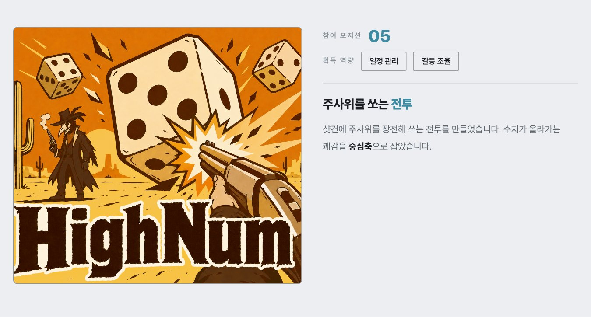
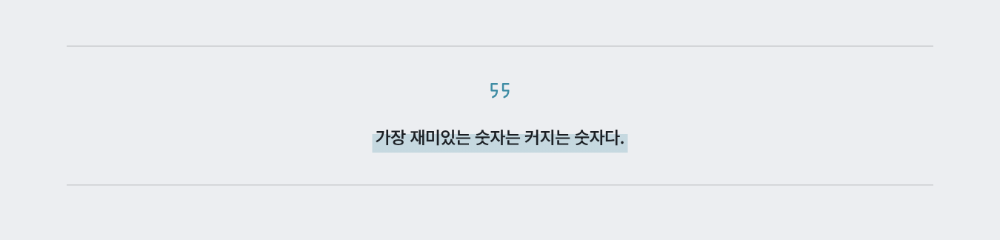
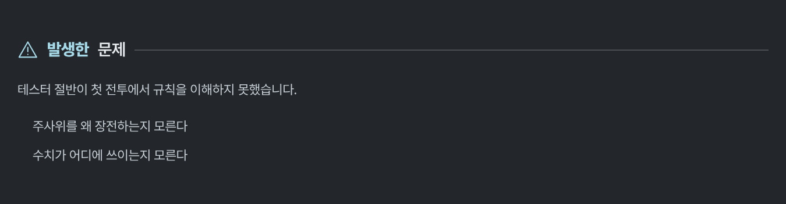
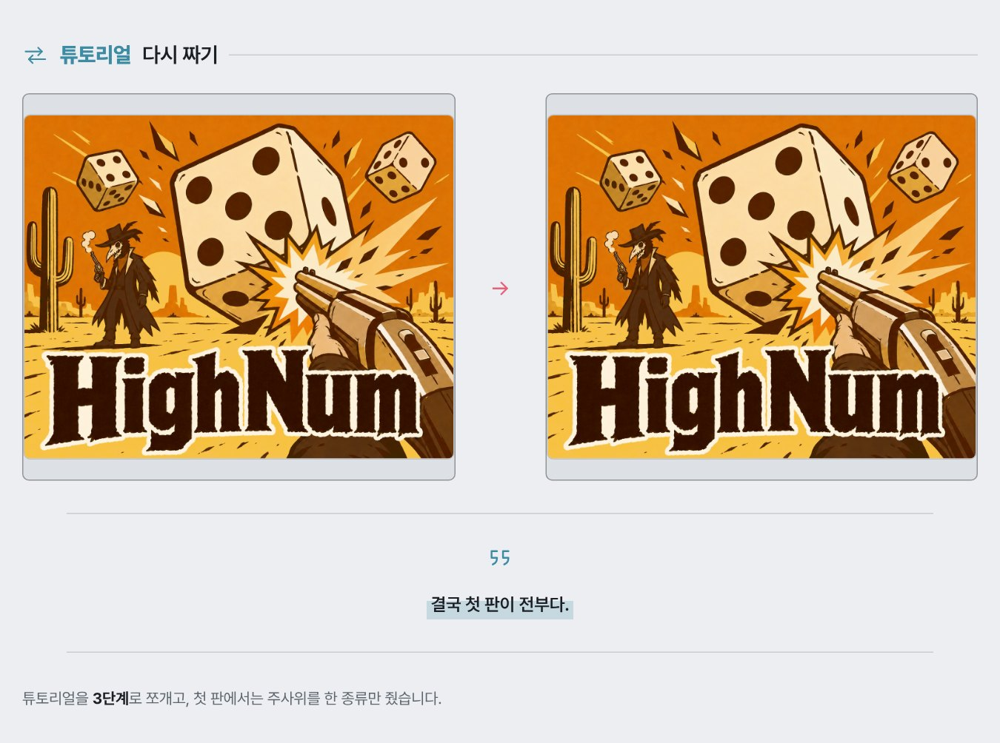
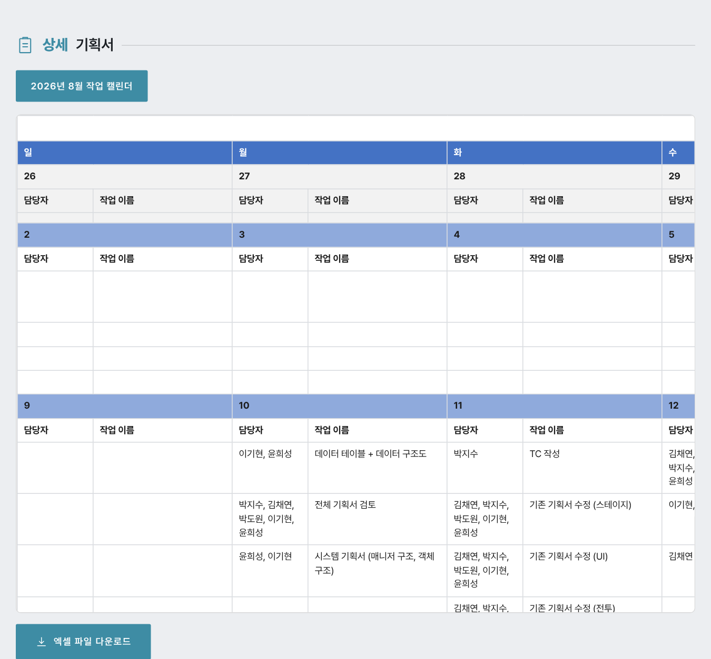
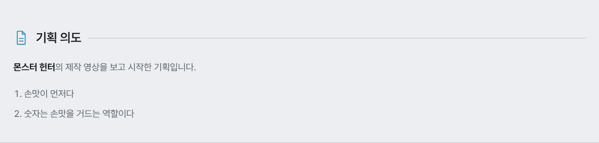
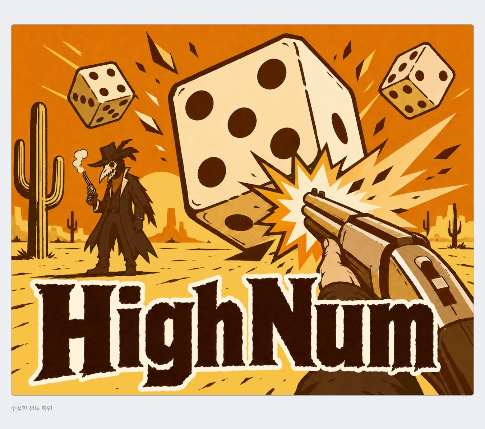
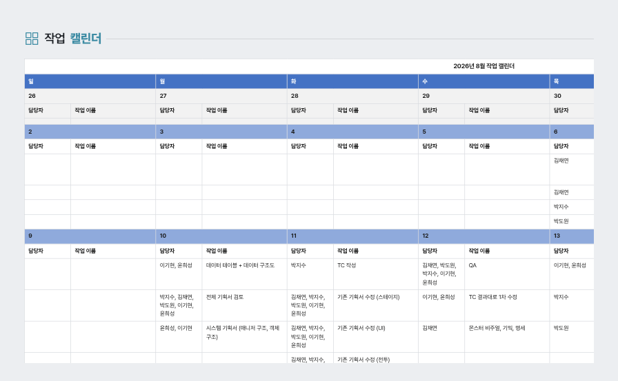
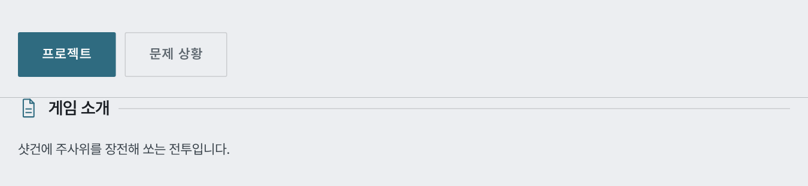

# 포트폴리오 편집 방법

## 가장 먼저 열 파일

`assets/data.js` 하나만 고치면 거의 모든 내용이 바뀝니다. 메모장이나 VS Code로 열어서 따옴표 안의 글자만 바꾸세요.

따옴표(`"`)와 쉼표(`,`)는 지우면 안 됩니다. 화면이 하얗게 나오면 십중팔구 따옴표나 쉼표가 빠진 것입니다.

## 페이지 구성

| 주소 | 내용 |
|---|---|
| `index.html` | 메인. 큰 화면 하나에 프로젝트를 한 개씩 보여 줍니다 |
| `portfolio.html` | 프로젝트 목록 |
| `project.html` | 프로젝트 상세 |
| `resume.html` | 이력서 |
| `cover-letter.html` | 자기소개서 |

메인의 큰 화면은 좌우 화살표로 프로젝트를 넘기고, 아래 띠를 누르면 그 프로젝트의 상세 페이지로 갑니다.

## 이미지·영상·파일 넣기

파일은 아래 폴더에 넣고, `data.js`에는 경로를 적습니다.

- 이미지: `assets/images/`
- 영상: `assets/videos/`
- 기획서: `assets/documents/`

경로에는 폴더 사이의 `/`를 반드시 넣습니다. 올바른 예시는 `assets/images/project-01-main.png`입니다.

## 프로젝트 입력

`projects` 배열의 각 항목을 고칩니다. 항목을 복사해 붙여 넣으면 프로젝트가 늘어납니다.

```js
{
  id:"project-01",                      // 주소에 쓰이는 이름. 겹치면 안 됩니다
  year:"2026",
  title:"프로젝트명",
  genre:"주사위, 전략",                  // 쉼표로 나누면 #태그로 표시됩니다
  role:"부팀장, PM",
  period:"2026.03 – 2026.08",           // 작업 기간
  position:"05",                        // 참여 포지션 수
  gains:"일정 관리, 갈등 조율",          // 획득 역량. 쉼표로 나누면 칸이 하나씩 생깁니다
  summary:"한 줄 설명",                  // 상세 페이지 윗부분의 큰 글씨
  body:"상세 설명",
  quote:"인용하고 싶은 한마디",           // 비워 두면 표시되지 않습니다
  problem:"작업 중 발생한 문제",          // 해결 과정 바로 위에 나옵니다
  solution:{                            // 해결 과정
    before:"assets/images/before.png",
    after:"assets/images/after.png",
    note:"어떻게 해결했는지 설명"
  },
  image:"assets/images/project-01-main.png",  // 목록·소개의 대표 이미지
  shortVideos:[{src:"https://www.youtube.com/watch?v=영상아이디", title:"영상 이름"}],
  images:[{src:"assets/images/01.png", alt:"설명"}],   // 소개 쪽 추가 이미지
  documents:[{title:"기획서 이름", src:"assets/documents/파일.pdf"}],
  md:``                                 // 상세 페이지 구성. 비워 두면 기본 구성대로 나옵니다
}
```

`team` 항목은 지금 화면에 나오지 않지만 지우지 않아도 됩니다.

### 상세 페이지 구성 — 양식 부르기 (`md` 칸)

프로젝트 상세 페이지의 **순서와 구성은 `md` 칸이 정합니다.**
`md`를 비워 두면 지금까지와 똑같이
`소개 → 인용 → 발생한 문제 → 해결 과정 → 상세 기획서` 순으로 나옵니다.

`md` 안에 **`@@양식이름`** 을 한 줄 적으면 그 자리에 그 양식이 들어갑니다.
적은 순서대로 위에서 아래로 쌓입니다.

```js
md:`
@@소개
---
제목: 주사위를 쏘는 전투
그림: assets/images/project-01-main.png

이 프로젝트는 **주사위**를 장전해 쏘는 전투를 만들고 싶어 시작했습니다.

@@문제
테스터 절반이 규칙을 이해하지 못했습니다.

@@해결
전: assets/images/before.png
후: assets/images/after.png

튜토리얼을 **3단계**로 쪼갰습니다.

@@기획서
`
```

#### 규칙 네 가지

1. **`@@이름` 한 줄이 양식 호출입니다.** 다음 `@@` 줄(또는 글 끝)까지가 그 양식의 내용입니다.
   **`@@` 만 적은 줄은 "여기서 끝"** 이라는 표시입니다. 넣어도 되고 안 넣어도 됩니다.
2. 이름 바로 아래 **`---` 한 줄은 보기 좋으라고 넣는 구분선**입니다. 있어도 없어도 똑같이 동작합니다.
3. **`키: 값` 줄**이 그 양식의 칸을 채웁니다. **한 양식 안이면 어디에 적어도 됩니다** —
   맨 위에 몰아서 적어도 되고, 글 쓰다가 중간에 적어도 되고, 사이에 빈 줄이 있어도 됩니다.

   | | 칸 이름 |
   |---|---|
   | 어디에 적든 위치가 정해진 칸 | `제목:` `그림:` `사진:` `아이콘:` `이름:` `설명:` `구역:` `포지션:` `역량:` `작업기간:`(=`기간:`) `장르:` `링크:` `그림위치:` |
   | **적은 자리에 그대로 나오는 칸** | `인용:` `전:` `후:` |

   여기 없는 낱말로 시작하는 `어쩌고: 저쩌고` 줄은 그냥 본문으로 들어갑니다.
   값은 **한 줄**입니다. 줄을 바꾸면 그 줄부터는 본문입니다.
4. **내용을 비워 두면 위쪽 항목(`summary`·`body`·`problem`·`solution`…)을 그대로 씁니다.**
   그래서 `@@소개` 한 줄만 적어도 지금 내용이 그대로 나옵니다.

내용에는 **마크다운**을 그대로 쓸 수 있습니다 — `**굵게**`, `- 목록`, `1. 번호`, `> 인용`, `[링크](주소)`, `### 작은 제목`.
목록 줄 앞에 탭이나 공백을 넣으면 **한 단계 안으로 들어갑니다.**

#### 강조하는 세 가지 방법

| 적는 법 | 나오는 모양 |
|---|---|
| `**굵게**` | **굵은 흰 글씨** |
| `==형광펜==` | 글자 뒤에 하늘색 형광펜 |
| `- 플랫폼: PC` | 목록에서 `낱말:` 로 시작하면 **그 낱말이 하늘색 라벨**이 됩니다 |

마지막 것은 따로 적을 게 없습니다. `- 장르: 덱빌딩 로그라이트` 처럼 적으면 "장르:"가 알아서 하늘색이 됩니다.
`인용:` 으로 넣은 인용 한마디에도 형광펜이 깔립니다.

#### 양식 한눈에 보기

| 호출 | 나오는 모양 | 밝기 |
|---|---|---|
| `@@소개` | 대표 이미지 + 참여 포지션·획득 역량 + 큰 제목 + 본문 | 밝게 |
| `@@인용` | 가는 선 사이의 인용 한마디 | 밝게 |
| `@@문제` | 발생한 문제 | 어둡게 |
| `@@해결` | 전 → 후 두 칸 + 설명 | 밝게 |
| `@@기획서` | 기획서 제목 버튼 + 뷰어 | 밝게 |
| `@@글` | 제목 + 본문 (자유 서술) | 밝게 |
| `@@이미지` | 이미지 한 장 + 아래 설명 | 밝게 |
| `@@표` | 엑셀 표 | 밝게 |

같은 양식을 다른 이름으로도 부를 수 있습니다 —
`@@해결` `@@해결과정` `@@해결방법`은 모두 같고, `@@그림`·`@@사진`은 `@@이미지`와 같습니다.
`@@포지션`은 소개 양식입니다(참여 포지션이 소개 안으로 들어갔습니다).

**목록에 없는 이름을 부르면 `글` 양식이 나오고 그 이름이 제목이 됩니다.**
`@@기획 의도`라고만 적으면 "기획 의도"라는 제목의 글 칸이 생깁니다. 양식 이름을 외울 필요가 없습니다.

---

### 양식별 작성법

아래 그림은 **왼쪽 코드를 그대로 적었을 때 실제로 나오는 모양**입니다.

---

#### `@@소개` — 대표 이미지 + 포지션·역량 + 한 줄 설명 + 본문

```
@@소개
---
제목: 주사위를 쏘는 **전투**
기간: 2026.03 – 2026.08
장르: 주사위, 롤플레잉, 전략
포지션: 05
역량: 일정 관리, 갈등 조율
그림: assets/images/project-01-main.png

샷건에 주사위를 장전해 쏘는 전투를 만들었습니다.
수치가 올라가는 쾌감을 **중심축**으로 잡았습니다.
```



- `제목:` 오른쪽 큰 글씨 — 비우면 `summary`. `**전투**` 처럼 감싸면 그 부분만 하늘색
- `기간:` (= `작업기간:`) 작업 기간 — 비우면 `period`
- `장르:` 쉼표로 나누면 가운뎃점(·)으로 이어 줍니다. 비우면 `genre`
- `포지션:` 비우면 `position`. **숫자면 크게, `부팀장, PM` 같은 글자면 본문 크기**로 나옵니다
- `역량:` 쉼표로 나누면 칸이 하나씩 생깁니다. 비우면 `gains`
- `그림:` 왼쪽 이미지 — 비우면 `image`
- `링크:` 게임 주소 등. **`이름 | 주소`** 형태로 적으면 그 이름의 단추가 생깁니다
  (예: `링크: itch.io 에서 플레이 | https://panasaga.itch.io/highnum`)
- 본문(빈 줄 아래) — 비우면 `body`. **둘 다 비면 본문 칸이 아예 나오지 않습니다**

작업 기간·장르·참여 포지션·획득 역량은 **한 줄 설명 위에 가는 선으로 묶여** 나옵니다.

**`@@소개` 한 줄만 적어도** 위 항목들을 그대로 가져와 지금 모양 그대로 나옵니다.

---

#### `@@인용` — 가는 선 사이의 한마디

```
@@인용
가장 재미있는 숫자는 커지는 숫자다.
```



- 내용이 곧 인용문입니다. 비우면 `quote`
- 한 줄짜리 양식입니다. 긴 글은 `@@글`을 쓰세요

---

#### `@@문제` — 발생한 문제 (어두운 칸)

```
@@문제
테스터 절반이 첫 전투에서 규칙을 이해하지 못했습니다.

- 주사위를 왜 장전하는지 모른다
- 수치가 어디에 쓰이는지 모른다
```



- 내용이 곧 본문입니다. 비우면 `problem`
- `제목:` 을 적으면 "발생한 문제" 대신 그 제목이 나옵니다
- `아이콘:` 으로 앞의 아이콘을 바꿉니다 (기본 `alert`)

---

#### `@@해결` — 전 → 후 두 칸 + 설명 (밝은 칸)

```
@@해결
제목: **튜토리얼** 다시 짜기
전: assets/images/before.png
후: assets/images/after.png
인용: 결국 첫 판이 전부다.

튜토리얼을 **3단계**로 쪼개고, 첫 판에서는 주사위를 한 종류만 줬습니다.
```



- `제목:` **"해결 과정" 대신 쓸 제목.** `**튜토리얼**` 처럼 감싸면 그 부분만 하늘색
- `전:` `후:` 두 이미지 — **적은 자리에 그대로 들어갑니다.** 글 쓰다가 중간에 넣어도 됩니다
- **이미지는 안 넣어도 됩니다.** `전:` `후:` 를 아예 안 쓰거나 값을 비우면 이미지 칸이 나오지 않고
  설명만 나옵니다. 하나만 넣으면 그 한 칸만 넓게 나옵니다 (화살표 없음)
- `전:` `후:` 를 한 번도 안 쓰면 `solution.before` / `solution.after` 를 맨 위에 넣습니다
- 본문은 설명으로 들어갑니다 — 비우면 `solution.note`
- `인용:` 인용 한마디를 그 자리에 넣습니다
- `아이콘:` 으로 앞의 아이콘을 바꿉니다 (기본 `swap`)
- 어두운 `@@문제` 다음에 밝은 `@@해결` 이 오면서 **문제 ↔ 해결이 번갈아** 보입니다

---

#### `@@기획서` — 제목 버튼 + 뷰어

```
@@기획서
```



- `documents` 항목을 그대로 보여 줍니다. 따로 적을 것이 없습니다
- 기획서가 여러 개면 위에 제목 버튼이 하나씩 생기고, 누르면 아래 내용이 바뀝니다
- **`이름:` 을 적으면 제목에 그 말이 들어간 기획서만** 보여 줍니다 (예: `이름: 컨셉 기획서`)
- 엑셀·이미지·PDF를 넣는 방법은 아래 **엑셀 파일** 항목을 보세요
- 본문을 적으면 뷰어 아래에 설명으로 붙습니다

---

#### `@@글` — 제목 + 본문 (자유 서술)

```
@@기획 의도
---
**몬스터 헌터**의 제작 영상을 보고 시작한 기획입니다.

1. 손맛이 먼저다
2. 숫자는 손맛을 거드는 역할이다
```



- **부른 이름이 그대로 제목이 됩니다.** 위 예시의 제목은 "기획 의도"
- `@@글` 이라고 부르고 `제목:` 을 따로 적어도 됩니다. 제목을 아예 안 적으면 본문만 나옵니다
- `아이콘:` 으로 앞의 아이콘을 바꿉니다 (기본 `doc`)
- 마크다운을 가장 자유롭게 쓸 수 있는 칸입니다

**`그림:` 을 적으면 기획서 슬라이드처럼 글 옆에 그림이 붙습니다.**

```
@@비주얼 컨셉
그림: assets/images/doc/concept.jpg
그림위치: 왼쪽

**톤 앤 매너**
- 검고 거친 선화
```

- 한 장이면 **글 옆**에 붙습니다. `그림위치: 왼쪽` 을 적으면 그림이 왼쪽으로 갑니다
- **쉼표로 여러 장**을 적으면 글 아래에 한 줄로 나란히 걸립니다 (최대 4장까지 보기 좋습니다)
- **줄을 맞추기 위해 그림이 조금 잘립니다.** 옆그림은 높이를 한 범위로 묶고,
  여러 장은 4:3으로 맞춰 아랫변이 가지런히 떨어집니다. 잘리면 안 되는 그림(도식·표 등)은
  `@@이미지` 로 한 장만 넣으세요 — 그때는 원본 그대로 가로폭을 꽉 채웁니다
- `설명:` 을 적으면 그림 아래에 작은 글씨로 들어갑니다
- 좁은 화면에서는 자동으로 위아래로 쌓입니다

---

#### `@@이미지` — 이미지 한 장 + 아래 설명

```
@@이미지
그림: assets/images/project-01-main.png
설명: 수정한 전투 화면
```



- `그림:` 넣을 이미지 (`@@사진` `@@그림` 으로 불러도 같습니다). **쉼표로 여러 장**을 적으면 한 줄로 나란히 걸립니다
- `설명:` 아래 작은 글씨. 없으면 이미지만 나옵니다
- `제목:` 을 적으면 이미지 위에 제목 줄이 생깁니다
- 가로폭을 꽉 채웁니다. 어두운 칸에 넣고 싶으면 `구역: 어둡게`

---

#### `@@표` — 엑셀 표

```
@@표
제목: 작업 **캘린더**
이름: work-calendar-2026-08
```



- `이름:` 은 `assets/sheets.js` 안에 들어 있는 이름입니다 (엑셀을 변환하면 생깁니다)
- 이름이 틀리면 "표를 찾을 수 없습니다" 안내가 나옵니다
- 표 칸만 흰 바탕을 그대로 씁니다. 엑셀 서식을 그대로 보여 주는 칸이라서입니다

---

#### 탭으로 나누기 (`@@탭 이름`)

**`@@탭 이름`** 한 줄을 적으면 거기서부터 그 이름의 탭이 시작됩니다.
다음 `@@탭` 을 만날 때까지의 양식이 모두 그 탭에 들어가고, **맨 처음 탭이 먼저 보입니다.**

```
@@소개
...

@@탭 프로젝트

@@글
제목: 게임 소개

샷건에 주사위를 장전해 쏘는 전투입니다.

@@탭 문제 상황

@@문제
테스터 절반이 첫 전투에서 규칙을 이해하지 못했습니다.
```



- **`@@탭` 앞에 적은 양식(소개·인용 등)은 탭과 상관없이 늘 보입니다.** 탭은 그 아래에 생깁니다
- 탭은 몇 개든 만들 수 있고, 이름은 마음대로 적으면 됩니다
- `@@탭` 을 하나도 안 쓰면 예전처럼 전부 이어서 나옵니다
- 탭마다 맨 아래에 `메인으로` 단추가 붙습니다

#### 아무 양식에나 인용 넣기

**`인용:` 은 어떤 양식에서나 쓸 수 있고, 적은 자리에 그대로 들어갑니다.**
글 중간에 넣으면 글 중간에, 제목 바로 아래에 넣으면 맨 위에 나옵니다.

```
@@문제
제목: PM이 해야하는 것

일정이 자꾸 지켜지지 않는다고 느꼈습니다.

인용: 대체 뭐라는거에요?

그러던 중 팀원 하나가 일정표에 대해 건의했습니다.
```

더 수수한 모양을 쓰고 싶으면 마크다운 인용(`> 글`)을 쓰세요.

#### 밝은 칸 / 어두운 칸

양식마다 기본 밝기가 정해져 있고(`@@문제`만 어둡게, 나머지는 밝게),
같은 밝기가 이어지면 사이 여백을 알아서 줄입니다.
바꾸고 싶으면 그 양식 안에 **`구역: 어둡게`** 또는 **`구역: 밝게`** 를 적습니다.

#### 제목 안에서 하늘색 쓰기

제목 칸에 `**해결** 과정`처럼 적으면 `**` 로 감싼 부분만 하늘색 굵은 글씨가 됩니다.

### 맨 위 16:9 화면

상세 페이지 맨 위의 큰 화면에는 **`shortVideos`의 첫 번째 영상이 바로 재생됩니다.** 소리는 꺼진 상태로 시작하고 반복 재생되며, 화면 아래 컨트롤로 소리를 켤 수 있습니다.

영상이 없으면 `image`(대표 이미지)가 대신 들어갑니다.

화면 오른쪽 위의 작은 그림들은 **다른 프로젝트 썸네일**입니다. 좌우로 밀어서 더 볼 수 있고, 누르면 그 프로젝트 내용으로 바뀝니다.

### 유튜브 영상

`shortVideos`의 `src`에 유튜브 주소를 그대로 붙여 넣으면 됩니다.

유튜브 제목·로고·추천 영상·컨트롤은 모두 꺼 두었기 때문에 **영상 화면만 보입니다.** 소리는 오른쪽 아래 `소리 켜기` 버튼으로 켭니다.

### 영상 파일로 넣기 (더 깔끔합니다)

유튜브를 아예 거치지 않으려면 영상 파일을 직접 넣는 쪽이 가장 좋습니다. 유튜브 스튜디오에서 내 영상을 내려받아(`콘텐츠 → 영상 → ⋮ → 다운로드`) 아래처럼 하면 됩니다.

1. 받은 파일을 `assets/videos/` 안에 넣습니다. 예: `assets/videos/high-num.mp4`
2. `data.js`에서 그 프로젝트의 `shortVideos`를 아래처럼 고칩니다.

```js
shortVideos:[{src:"assets/videos/high-num.mp4", title:"High Num 소개 영상"}]
```

이렇게 하면 인터넷이 없어도, 파일을 더블클릭해서 열어도 바로 재생됩니다. 용량이 100MB를 넘으면 깃허브에 올라가지 않으니 그때는 유튜브 주소를 쓰세요.

**파일을 더블클릭해서 열면(주소가 `file://`) 유튜브가 재생을 막는 경우가 있습니다**(`오류 153`). 유튜브 정책이라 페이지 쪽에서는 풀 수 없습니다. 아래 두 가지 중 하나를 쓰세요.

1. 공개 주소 https://salmonsla119.github.io/Portfolio/ 로 연다 (가장 간단합니다)
2. 영상 파일을 `assets/videos`에 넣고 `{src:"assets/videos/영상.mp4"}` 로 적는다 (인터넷 없이도 재생됩니다)

### 엑셀 파일

브라우저는 파일을 더블클릭해 열었을 때 엑셀 내용을 직접 읽지 못합니다. 그래서 표 내용을 미리 뽑아 둔 `assets/sheets.js`를 만들어 두고 그것을 표로 그립니다. 원본 엑셀은 다운로드용으로 그대로 씁니다.

1. 엑셀 파일을 `assets/documents/` 안에 넣습니다(파일 이름은 영문·숫자 권장).
2. 아래 명령을 한 번 실행합니다. 파이썬만 있으면 됩니다.

```bash
python tools/xlsx-to-sheets.py assets/documents/파일이름.xlsx 키이름
```

3. `documents`에 아래처럼 적습니다. `sheet`에는 2번에서 쓴 키이름을 넣습니다.

```js
documents:[
  {title:"2026년 8월 작업 캘린더", src:"assets/documents/work-calendar-2026-08.xlsx", sheet:"work-calendar-2026-08"}
]
```

엑셀을 고친 뒤에는 2번 명령을 다시 실행해야 화면에도 반영됩니다.

## 특기 사항 (메인 첫 화면 오른쪽)

`data.js`의 `specialties`를 고칩니다. 첫 화면 오른쪽에 목록으로 나오고, **마우스를 올리면 그 옆에 설명이 뜹니다.** 누르면 그 항목이 고정됩니다(다시 누르면 해제).

```js
{icon:"art", eyebrow:"GRAPHIC", title:"아트 실무 경험", detail:"설명"}
```

`icon`에 쓸 수 있는 값은 `art`(팔레트) `grit`(불꽃) `time`(시계) `team`(두 사람) 네 가지입니다. 항목을 더 늘리면 칸도 같이 늘어납니다.

## 이력서 입력

- **기본 정보(이름·생년월일·전화·이메일)**는 `resume.html` 안에 직접 적혀 있습니다.
- **보유 기술**: `data.js`의 `skills`. `level`은 0~100이고, 20으로 나눈 만큼 점이 채워집니다.
- **인적사항**: `resumePersonalInfo`의 `year`, `history`
- **경력**: `resumeCareers`의 `period`, `company`, `role`, `detail`
- **프로젝트**: `resumeProjects`의 `year`, `title`, `role`, `detail`
- **자격증·수상 이력**: 아직 틀만 있습니다. 내용이 생기면 알려 주세요.
- **원본 PDF**: `assets/kim-chaeyeon-resume.pdf`를 바꿔 넣으면 됩니다.

내용이 비어 있는 항목은 "입력"이라는 안내 글씨가 대신 나옵니다.

## 자기소개서 수정

`data.js`의 `coverLetter`를 고칩니다. 마크다운 문법을 그대로 쓸 수 있습니다.

- `## 제목` → 소제목
- 빈 줄로 문단을 나눕니다
- `**굵게**`
- `> 인용` → 회색 상자
- `---` → 구분선

## 색상·글씨 크기 변경

`assets/style.css` 맨 위 `:root`의 값만 바꾸면 전 페이지가 함께 바뀝니다.

```
--bg      페이지 배경          --bg-2    한 단계 어두운 띠
--box     상자                 --screen  영상·이미지 칸 바탕
--accent  포인트 하늘색        --rose    아주 작은 분홍
--text    본문 글자            --sub     보조 글자
--dim     흐린 글자            --line    가는 선
```

글씨 크기도 같은 곳에 모여 있습니다. 여기만 고치면 사이트 전체의 글씨가 같이 커지고 작아집니다.

```
--fs-label  작은 라벨(11px)    --fs-small  버튼·보조(12px)
--fs-body   본문(14px)         --fs-lead   인용(16px)
--fs-h2     섹션 제목          --fs-h1     페이지 제목
--fs-hero   메인 큰 제목
```

전체 분위기는 **어두운 차콜 바탕 + 가는 선 + 연한 하늘색 포인트**이고, 밝은 구역과 어두운 구역이 번갈아 나옵니다.

- 메인: 첫 화면(어두움) → 프로젝트 더보기(밝음)
- 프로젝트 상세: 영상(어두움) → 소개(밝음) → 해결 과정(어두움) → 상세 기획서(밝음)
- 이력서는 어둡고, 자기소개서는 밝습니다.

어떤 구역을 밝게/어둡게 바꾸고 싶으면 그 구역에 `on-light` 클래스를 붙이거나 떼면 됩니다. 색은 알아서 따라갑니다.

## 아이콘

제목 옆의 작은 선 아이콘은 `assets/app.js` 맨 위 `ICONS`에 모여 있습니다. 쓸 수 있는 이름은 다음과 같습니다.

`doc`(문서) `pen`(펜) `grid`(바둑판) `film`(영상) `sound`/`mute`(소리) `quote`(따옴표) `swap`(화살표 두 개) `clip`(클립보드) `down`(내려받기) `back`(뒤로) `image`(그림) `user`(사람) `badge`(자격증) `award`(별) `case`(가방) `layers`(겹친 판) `tool`(설정) `alert`(느낌표) `hybrid`(문서 + 붓질)

**직접 그린 아이콘을 넣고 싶으면** SVG 파일을 주세요. 그대로 `ICONS`에 넣어 드립니다(색과 크기는 사이트 설정을 자동으로 따라갑니다). 메인 문구 앞의 `hybrid`(문서에 붓칠)가 그렇게 넣은 아이콘입니다.

HTML에서 제목에 아이콘을 붙이려면 그 태그에 `data-ico="이름"`만 적으면 됩니다.

```html
<h2 data-ico="award">수상 이력</h2>
```

## 사이트 올리기

`main` 브랜치에 올리면 1~2분 뒤 https://salmonsla119.github.io/Portfolio/ 에 자동으로 반영됩니다.

## 이전 디자인

크림색 바탕에 남색 테두리와 도트 픽셀을 쓰던 이전 디자인은 `design-v1` 브랜치에 그대로 남아 있습니다. 되돌리고 싶으면 알려 주세요.
